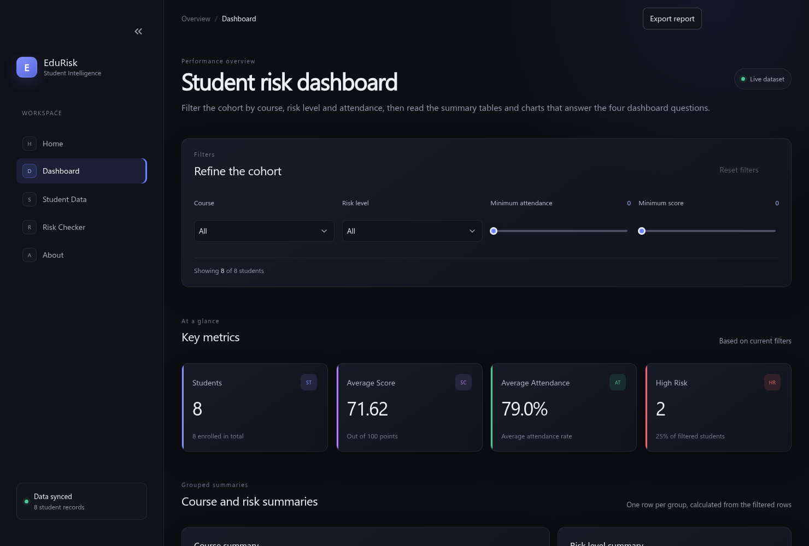
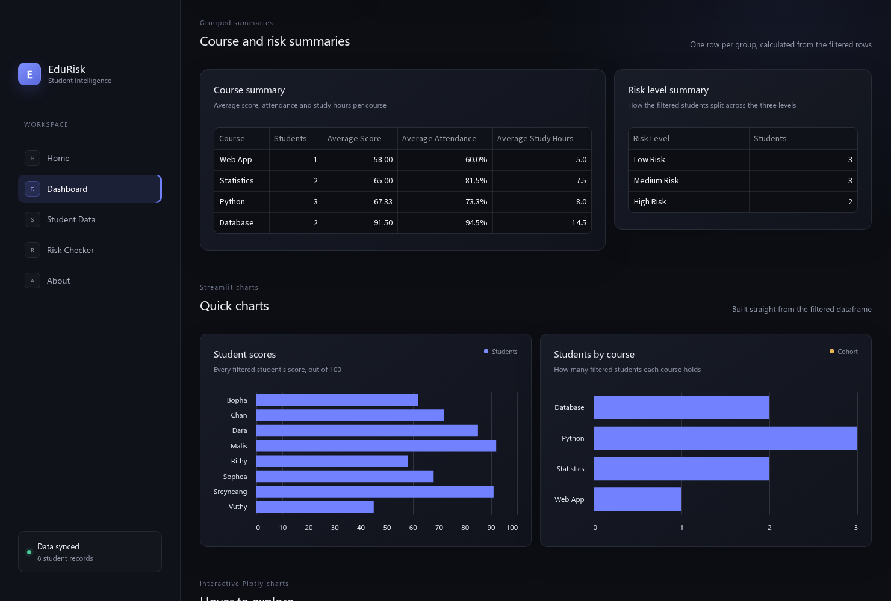
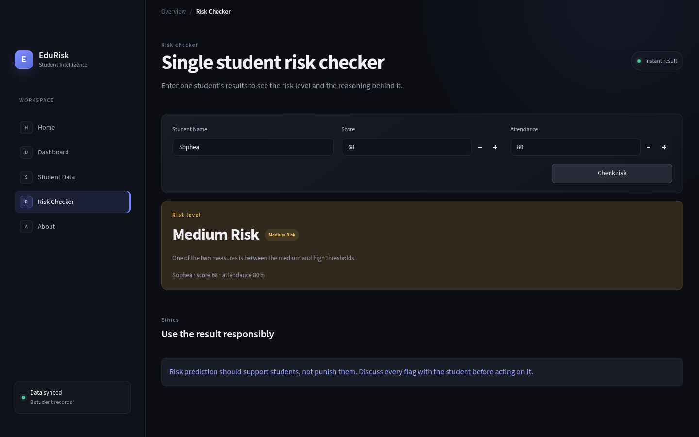

# EduRisk Analytics

A student early-warning dashboard built with **Streamlit**, **Pandas**, **Altair**
and **Plotly**. It turns a cohort CSV into a filterable, interactive risk view so a
lecturer can see who needs support before the final exam, not after it.



**🌐 Live demo:** https://thay-edurisk.streamlit.app/

**Lab 05 — Visualization and Interactivity** (continues from Lab 04)

## The problem

End-of-term results tell a lecturer who failed. They do not tell them *who to call
this week*. EduRisk Analytics puts score, attendance and study hours on one screen,
labels each student with a transparent risk rule, and explains every label so the
result can be discussed with the student instead of silently acted on.

## What it does

| Page | Purpose |
|---|---|
| **Dashboard** | Interactive analytical view: cohort filters (course, risk level, minimum score/attendance), four filtered KPI cards, grouped course and risk summary tables, Streamlit charts, interactive Plotly charts, score distribution and the filtered records table |
| **Student Data** | Full student table with the calculated risk level, a data-inspection block, and CSV download of the whole cohort (the Dashboard exports the filtered view) |
| **Risk Checker** | Enter one student's score and attendance through a validated form to see the risk level and the reason behind it; recent checks stay in the session |
| **About** | Project scope, stack and author |

Other features: custom dark theme (`design/theme.py`), export-report button,
missing-CSV error handling, and an ethics reminder on the risk page.

## What Lab 05 adds

The lab turns the Dashboard into an interactive analytical dashboard. Everything
below lives in `app.py`, and the summary maths and Plotly figures are covered by
the unit tests while the click-through is covered by `tests/test_app_flow.py`:

```text
- import plotly.express as px, and plotly in requirements.txt
- Dashboard filters in one row: course, risk level, minimum attendance
  (the Lab 04 export still reads the same session state)
- A single filtered_df built with .copy() before any number is calculated
- st.warning("No students match the selected filters. Please adjust the filters.")
- Filtered metric cards: Students, Average Score, Average Attendance, High Risk
- Course summary: groupby("Course").agg(...) - students, average score,
  average attendance, average study hours, weakest average score first
- Risk level summary: value_counts(), re-read in a fixed Low -> Medium -> High
  order so a level with zero students stays visible
- Streamlit charts: st.bar_chart for student scores and students by course
- Plotly charts: px.bar risk distribution and scores by risk level, with the
  same green / amber / red risk palette and hover tooltips
- Filtered student records table at the bottom of the Dashboard
- Ethics reminder on the Dashboard and About pages
```

Every section guards itself when the filters match nobody: the page shows one
warning, the cards fall back to an empty-state note, and nothing divides by zero.



## What Lab 04 adds

The Risk Checker page keeps the form-based workflow from Lab 04, unchanged:

```text
- st.form() grouping the three inputs
- st.form_submit_button("Check risk") — nothing is calculated until it is clicked
- Empty student name validation ("Please enter the student name.")
- Supportive feedback per level: green success, yellow warning, red error
- st.session_state["risk_history"] — temporary list of recent checks
- Recent Risk Checks table, built with Pandas from that list
- Clear History button, with a one-shot confirmation message
```

Session state is temporary by design: the history is dropped when the browser
session ends and nothing is ever written back to `students.csv`.

## The risk rule

The dashboard ships with a transparent, auditable rule rather than a black box:

| Condition | Risk level |
|---|---|
| Score < 60 **or** attendance < 60 | High Risk |
| Score < 75 **or** attendance < 75 | Medium Risk |
| Otherwise | Low Risk |
| Missing score or attendance | High Risk (cannot be cleared) |

`classify_risk()` in `app.py` is the only business rule in the app. Replacing that
one function with a trained model would make the whole dashboard model-driven
without touching the layout.



## Tech stack

- Python 3.11+ (CI uses 3.12)
- Streamlit 1.51+ (tested on 1.66)
- Pandas 2.2+ (tested on 3.1)
- Altair (distribution chart)
- Plotly (interactive charts)
- `unittest` for the logic tests, Streamlit `AppTest` for the flow tests
- GitHub Actions running the test suite on every push

## Project structure

```
EduRiskAnalysis/
├── app.py                     # the whole dashboard: data, widgets, pages
├── design/theme.py            # palette + injected stylesheet
├── .streamlit/config.toml     # Streamlit theme matching the palette
├── students.csv               # sample cohort (8 records, synthetic)
├── tests/test_logic.py        # risk rule, filters, metrics, summaries, figures
├── tests/test_app_flow.py     # headless AppTest flow: form, history, dashboard
├── tests/__init__.py          # package init; silences Streamlit's bare-mode noise
├── assets/                    # README screenshots
├── requirements.txt
└── .github/workflows/tests.yml
```

`app.py` is deliberately one top-to-bottom script in seven labelled sections
(setup, data, settings, widgets, page parts, pages, run) because Streamlit re-runs
the file on every interaction. The docstring at the top explains the reading order.

## Getting started

```bash
git clone https://github.com/Thay32-Heng/EduRiskAnalysis.git
cd EduRiskAnalysis
python3 -m venv .venv
source .venv/bin/activate
pip install -r requirements.txt
streamlit run app.py
```

The app opens at `http://localhost:8501`.

### Tests

```bash
python -m unittest discover -s tests -t . -v
```

87 tests cover the risk boundaries (59.9 / 60 / 74.9 / 75), missing values,
the four cohort filters, the active-filter counter, the metric helpers, the
grouped summary tables, the Plotly figure data, the axis ticks, the CSV contract,
and the Lab 04 form logic (name validation, the history record, the history table
and the feedback messages).

`tests/test_app_flow.py` adds the *flow* tests: it runs `app.py` with Streamlit's
`AppTest` and clicks the real widgets - submit the form, get the warning for an
empty name, watch the history grow, clear it in one click, then filter the
dashboard by course, risk level and attendance and read the tables back. That
suite is what catches a broken append, a validation gate that stopped working or
a dashboard that divides by zero; the plain unit tests cannot see any of them.
The same command runs in CI.

## Data

`students.csv` is a small **synthetic** sample used for the prototype — it is not
real student data.

| Column | Type | Notes |
|---|---|---|
| `Student Name` | text | Display name |
| `Course` | text | Python, Statistics, Database, Web App |
| `Score` | 0–100 | Latest assessment score |
| `Attendance` | 0–100 | Attendance percentage |
| `Study Hours` | number | Weekly self-reported study hours |

Swap in a real export with the same columns and the app works unchanged.

## Limitations and next steps

- The risk level is **rule-based, not predictive**. A next version would compare
  the rule against a logistic regression or gradient-boosting baseline and report
  precision/recall on held-out terms.
- The dataset is 8 synthetic rows. Real use needs a registrar export, a data
  dictionary and a privacy review before any student data is displayed.
- No authentication or persistence: filters live in `st.session_state` and reset
  on reload.
- Planned: per-course trend lines across terms, an alert log for students already
  contacted, and configurable thresholds per course.

## Author

**Heng Sengthay** — Student ID 73191
Data Science of Engineering, Year 3, Royal University of Phnom Penh
Course project: Web App Development for Data Science (Lab 05)
GitHub: [@Thay32-Heng](https://github.com/Thay32-Heng)

## Student information

```text
Name: Heng Sengthay
Student ID: 73191
Class: M2
```

## Required files

```text
app.py
students.csv
requirements.txt
README.md
```

`design/theme.py` and `.streamlit/config.toml` hold the styling and are needed
for the app to look the way it does. Do not submit `.venv/`, `__pycache__/` or
`filtered_student_data.csv`.

## License

MIT — see [LICENSE](LICENSE).
