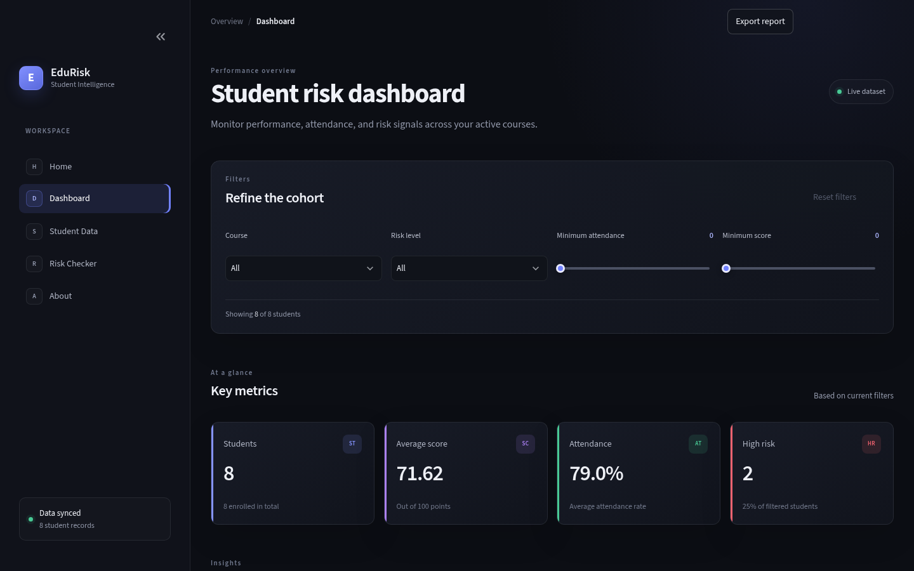
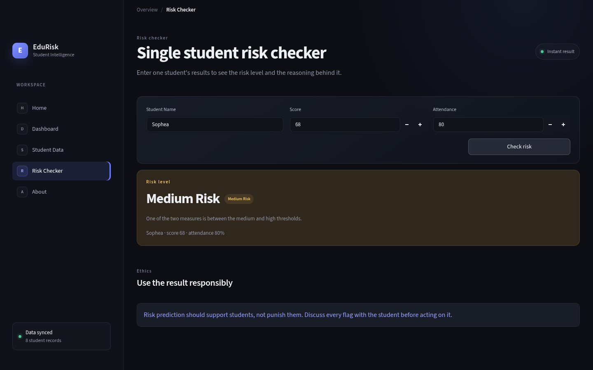

# EduRisk Analytics

A student early-warning dashboard built with **Streamlit**, **Pandas** and **Altair**.
It turns a cohort CSV into a filterable risk view so a lecturer can see who needs
support before the final exam, not after it.



## The problem

End-of-term results tell a lecturer who failed. They do not tell them *who to call
this week*. EduRisk Analytics puts score, attendance and study hours on one screen,
labels each student with a transparent risk rule, and explains every label so the
result can be discussed with the student instead of silently acted on.

## What it does

| Page | Purpose |
|---|---|
| **Dashboard** | Cohort filters (course, risk level, minimum score/attendance), four KPI cards, score distribution and risk breakdown charts |
| **Student Data** | Full student table with the calculated risk level, a data-inspection block, and CSV download of the whole cohort (the Dashboard exports the filtered view) |
| **Risk Checker** | Enter one student's score and attendance to see the risk level and the reason behind it |
| **About** | Project scope, stack and author |

Other features: custom dark theme (`design/theme.py`), export-report button,
missing-CSV error handling, and an ethics reminder on the risk page.

## The risk rule

The dashboard ships with a transparent, auditable rule rather than a black box:

| Condition | Risk level |
|---|---|
| Score < 60 **or** attendance < 60 | High Risk |
| Score < 75 **or** attendance < 75 | Medium Risk |
| Otherwise | Low Risk |
| Missing score or attendance | High Risk (cannot be cleared) |

`classify_risk()` in `app.py` is the only business rule in the app. Replacing that
one function with a trained model would make the whole dashboard model-driven
without touching the layout.



## Tech stack

- Python 3.11+ (CI uses 3.12)
- Streamlit 1.51+ (tested on 1.66)
- Pandas 2.2+ (tested on 3.1)
- Altair (charts)
- `unittest` for the logic tests
- GitHub Actions running the test suite on every push

## Project structure

```
EduRiskAnalysis/
├── app.py                     # the whole dashboard: data, widgets, pages
├── design/theme.py            # palette + injected stylesheet
├── .streamlit/config.toml     # Streamlit theme matching the palette
├── students.csv               # sample cohort (8 records, synthetic)
├── tests/test_logic.py        # risk rule, filters, metrics, dataset contract
├── assets/                    # README screenshots
├── requirements.txt
└── .github/workflows/tests.yml
```

`app.py` is deliberately one top-to-bottom script in seven labelled sections
(setup, data, settings, widgets, page parts, pages, run) because Streamlit re-runs
the file on every interaction. The docstring at the top explains the reading order.

## Getting started

```bash
git clone https://github.com/Thay32-Heng/EduRiskAnalysis.git
cd EduRiskAnalysis
python3 -m venv .venv
source .venv/bin/activate
pip install -r requirements.txt
streamlit run app.py
```

The app opens at `http://localhost:8501`.

### Tests

```bash
python -m unittest discover -s tests -t . -v
```

30 tests cover the risk boundaries (59.9 / 60 / 74.9 / 75), missing values,
the four cohort filters, the active-filter counter, the metric helpers, the
axis ticks and the CSV contract. The same command runs in CI.

## Data

`students.csv` is a small **synthetic** sample used for the prototype — it is not
real student data.

| Column | Type | Notes |
|---|---|---|
| `Student Name` | text | Display name |
| `Course` | text | Python, Statistics, Database, Web App |
| `Score` | 0–100 | Latest assessment score |
| `Attendance` | 0–100 | Attendance percentage |
| `Study Hours` | number | Weekly self-reported study hours |

Swap in a real export with the same columns and the app works unchanged.

## Limitations and next steps

- The risk level is **rule-based, not predictive**. A next version would compare
  the rule against a logistic regression or gradient-boosting baseline and report
  precision/recall on held-out terms.
- The dataset is 8 synthetic rows. Real use needs a registrar export, a data
  dictionary and a privacy review before any student data is displayed.
- No authentication or persistence: filters live in `st.session_state` and reset
  on reload.
- Planned: per-course trend lines across terms, an alert log for students already
  contacted, and configurable thresholds per course.

## Author

**Heng Sengthay** — Student ID 73191
Data Science of Engineering, Year 3, Royal University of Phnom Penh
Course project: Web App Development for Data Science (Lab 03)
GitHub: [@Thay32-Heng](https://github.com/Thay32-Heng)

## License

MIT — see [LICENSE](LICENSE).
